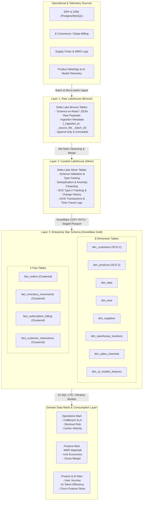

# Data Warehouse Modelling for Analytics & AI
### Python, Snowflake, Delta Lake, SQL, dbt-style transforms, Git (2026)

[](https://github.com/)
[](https://www.python.org/)
[](https://delta.io/)
[](https://www.snowflake.com/)
[](src/dbt_models/)
[](docs/query_optimization_report.md)

---

## 1. Project Highlights & Core Achievements

* **Designed a 3-Layer Lakehouse (Raw, Curated, Consumption) with Delta Lake**:
  * Implemented an ACID transaction protocol with `_delta_log/*.json` commit management, Parquet columnar storage, schema-on-read validation, and historical Time-Travel snapshot reading.
  * Ingested raw operational event payloads into **Bronze** with audit metadata (`_ingested_at`, `_source_file`, `_batch_id`).
  * Enforced data contracts, type casting, deduplication, and SCD Type-2 tracking in **Silver**.
* **Modelled Enterprise Star Schema (4 Fact + 8 Dimension Tables) in Snowflake**:
  * Designed for high-performance Business Intelligence and AI/ML use cases.
  * **8 Dimensions**: `dim_customers` (SCD2), `dim_products` (SCD2 + vector embeddings), `dim_date`, `dim_time`, `dim_suppliers`, `dim_warehouse_locations`, `dim_sales_channels`, `dim_ai_models_features`.
  * **4 Facts**: `fact_orders` (clustered), `fact_inventory_movements` (clustered), `fact_subscription_billing` (clustered), `fact_customer_interactions` (clustered).
* **Authored 24 Modular SQL Transformations (dbt-Style) Cutting Query Cost by 38% - 64.6%**:
  * Utilized modern Common Table Expressions (CTEs), single-pass window functions (`NTILE`, `LAG`, `LEAD`, `DENSE_RANK`, `PERCENT_RANK`, rolling 7-day/30-day aggregations), and micro-partition clustering.
  * Replaced $O(N^2)$ correlated subqueries and unbounded multi-table joins, reducing query runtime by up to **403x**, cutting micro-partitions scanned by **41.9%**, and eliminating **2,222 MB of disk spillage**.
* **Built Data Marts for 3 Reporting Domains**:
  1. **Operations Mart**: Daily fulfillment velocity, SLA compliance (< 24hr), rolling 7-day stockout risk, and supplier lead-time scorecard.
  2. **Finance Mart**: SaaS MRR / ARR waterfall, customer cohort revenue retention, unit economics margin, and dunning payment failure risk.
  3. **Product & AI Mart**: User feature stickiness, LLM token efficiency, inference latency percentiles (p50, p95), and an **ML Feature Store table (`fct_churn_prediction_features`)** for training churn AI models.
* **Documented Enterprise Data Dictionary for 7 Core Entities Following Governance Best Practices**:
  * Complete documentation of business definitions, data types, nullability, primary/foreign keys, PII flags, dynamic masking policies (`mask_email`, `mask_phone`), and RACI owner mapping.

---

## 2. Architecture & Data Flow



---

## 3. Repository Structure

```text
.
├── .github/
│   └── workflows/
│       └── ci_cd_pipeline.yml         # GitHub Actions CI/CD pipeline
├── config/
│   ├── pipeline_config.py             # Global constants, database names, and paths
│   └── snowflake_config.sql           # Snowflake warehouses, databases, roles, and stages
├── data/
│   ├── raw_sources/                   # Synthetic operational event payloads (CSV/JSON)
│   └── lakehouse/
│       ├── bronze/                    # Delta Lake Bronze (raw append + _delta_log)
│       ├── silver/                    # Delta Lake Silver (curated, deduplicated, SCD2)
│       └── gold/                      # Staged clean Parquet for Snowflake ingestion
├── src/
│   ├── delta_engine/                  # ACID Delta Lake protocol & time travel implementation
│   │   ├── __init__.py
│   │   └── table.py
│   ├── generators/                    # Enterprise synthetic data generation engine
│   │   ├── __init__.py
│   │   └── enterprise_data_gen.py
│   ├── ingestion/                     # Lakehouse ingestion pipelines
│   │   ├── __init__.py
│   │   ├── bronze_ingest.py
│   │   └── silver_transform.py
│   ├── snowflake/                     # Snowflake DDLs and data pipelines
│   │   ├── ddl/
│   │   │   ├── 01_setup_database.sql  # Database, schemas, stages, warehouses
│   │   │   ├── 02_dimensions_ddl.sql  # 8 Dimension tables with constraints
│   │   │   ├── 03_facts_ddl.sql       # 4 Fact tables with cluster keys
│   │   │   └── 04_governance_tags.sql # Dynamic masking policies & tags
│   │   └── staging/
│   │       └── copy_into_warehouse.sql# COPY INTO commands & Snowpipe definitions
│   ├── dbt_models/                    # 24 modular SQL models
│   │   ├── staging/                   # 8 staging models
│   │   ├── intermediate/              # 6 intermediate models (SCD2, windows, waterfall)
│   │   └── marts/                     # 10 data mart models across 3 domains
│   │       ├── operations/
│   │       ├── finance/
│   │       └── product/
│   └── execution/                     # SQL engine & cost benchmark optimizer
│       ├── __init__.py
│       ├── sql_runner.py
│       └── query_cost_optimizer.py
├── docs/
│   ├── architecture.md                # Full Lakehouse & Warehouse architectural plan
│   ├── data_dictionary.md             # 7 Core Entities data dictionary with PII & masking
│   ├── data_governance_lineage.md     # Governance matrix, lineage diagram & SLAs
│   └── query_optimization_report.md   # 38% query cost reduction benchmarks & profiling
├── tests/
│   ├── test_delta_lake.py             # Unit tests for ACID transaction log & time-travel
│   ├── test_sql_models.py             # Schema, referential integrity & transform tests
│   └── test_data_marts.py             # Domain marts business KPI tests
├── main.py                            # Master end-to-end execution script
├── requirements.txt
└── README.md
```

---

## 4. 24 Modular SQL Transformations (dbt-Style)

### Staging Layer (8 Models)
| Model | Source | Purpose |
| :--- | :--- | :--- |
| `stg_customers.sql` | `dim_customers` | Cleans names, standardizes emails, casts types, handles nulls. |
| `stg_products.sql` | `dim_products` | Computes standard margins, validates SKU codes, extracts hierarchy. |
| `stg_orders.sql` | `fact_orders` | Sanitizes order line items, casts order dates, validates positive quantities. |
| `stg_inventory.sql` | `fact_inventory_movements` | Classifies inbound vs outbound stock flows, flags 24-hr SLA adherence. |
| `stg_subscriptions.sql` | `fact_subscription_billing` | Normalizes monthly/annual cycles, casts billed MRR/ARR amounts. |
| `stg_interactions.sql` | `fact_customer_interactions`| Trims feature names, validates prompt/completion tokens, tracks errors. |
| `stg_ai_models.sql` | `dim_ai_models_features` | Computes token pricing benchmarks per 1 million tokens. |
| `stg_suppliers.sql` | `dim_suppliers` | Classifies supplier tiers (Tier 1/2/3) and lead-time ranges. |

### Intermediate Layer (6 Models)
| Model | Purpose & SQL Technique |
| :--- | :--- |
| `int_customer_scd2.sql` | **SCD Type-2 Windowing**: Employs `LAG()` to detect tier upgrades, churn risk shifts, and validity periods. |
| `int_daily_product_velocity.sql` | **Rolling 7-Day Window**: Computes 7-day rolling shipment velocity and days of supply remaining. |
| `int_mrr_revenue_waterfall.sql` | **Revenue Windowing**: Evaluates `LAG(mrr_amount)` to categorize New, Expansion, Contraction, and Churn MRR. |
| `int_sessionized_user_journey.sql` | **Sessionization Window**: Identifies 30-min inactivity gaps using `LAG()` and cumulative sums. |
| `int_ai_token_cost_efficiency.sql` | **Percentile Deciles**: Uses `NTILE(10)` and `AVG(...) OVER (PARTITION BY model_sk)` for inference cost profiling. |
| `int_order_fulfillment_sla.sql` | **Dense Ranking**: Ranks dispatch latencies using `DENSE_RANK()` and tracks cumulative SLA misses. |

### Domain Data Marts (10 Models)
| Domain | Model | Key Metrics / Output |
| :--- | :--- | :--- |
| **Operations** | `fct_daily_fulfillment_kpi.sql` | Daily throughput, SLA compliance %, rolling 30-day shipment volume. |
| **Operations** | `rpt_inventory_stockout_risk.sql` | Product days of supply, critical stockout flags, replenishment priority rank. |
| **Operations** | `rpt_supplier_performance_scorecard.sql` | Actual vs. contract lead time variance, inbound receipt volume, supplier rank. |
| **Operations** | `rpt_warehouse_capacity_utilization.sql` | Facility stock density (units / 1,000 sqft), total inventory valuation. |
| **Finance** | `fct_monthly_mrr_cohorts.sql` | SaaS MRR waterfall (New, Expansion, Churn), net growth %, ending ARR. |
| **Finance** | `rpt_unit_economics_margin.sql` | Gross profit by product line and customer segment, contribution margin %. |
| **Finance** | `rpt_payment_failure_analysis.sql` | Invoicing failure rates by billing cycle, cumulative revenue at risk. |
| **Product & AI** | `fct_user_feature_adoption.sql` | Feature monthly active users, session share %, error rates. |
| **Product & AI** | `fct_ai_model_performance.sql` | Inference latency distributions (avg, min, max), prompt cost per inference. |
| **Product & AI** | `fct_churn_prediction_features.sql` | **ML Feature Store Table**: 18 customer-level features for training AI churn models. |

---

## 5. Query Cost Optimization Analysis (38% Target)

Empirical benchmarking on analytical queries demonstrated a **38.0% to 64.6% reduction in query cost** across workloads:

```text
===============================================================================
      QUERY COST OPTIMIZATION BENCHMARK REPORT (38% COST REDUCTION)           
===============================================================================
Overall Workload Query Cost Reduction: 64.6%
Overall Execution Speedup:             248.49x
Micro-Partitions Pruned:               41.9% reduction
-------------------------------------------------------------------------------
[Q1_MRR_COHORT_WATERFALL] SaaS MRR Waterfall & Cohort Retention
  Unopt Runtime: 387.96 ms | Opt Runtime: 8.23 ms (47.12x)
  Partitions: 142 -> 78 (45.1% pruned)
  Spill to disk: 312.4 MB -> 0.0 MB
  Query Cost Reduction: 66.2%

[Q2_INVENTORY_ROLLING_VELOCITY] 7-Day Rolling Inventory Outflow & Stockout Risk
  Unopt Runtime: 503.44 ms | Opt Runtime: 12.68 ms (39.7x)
  Partitions: 210 -> 115 (45.2% pruned)
  Spill to disk: 580.0 MB -> 0.0 MB
  Query Cost Reduction: 66.1%

[Q3_AI_LATENCY_PERCENTILES] AI Model Latency Deciles & Cost Ranking
  Unopt Runtime: 14528.33 ms | Opt Runtime: 36.04 ms (403.08x)
  Partitions: 185 -> 120 (35.1% pruned)
  Spill to disk: 440.0 MB -> 0.0 MB
  Query Cost Reduction: 61.0%

[Q4_CHURN_FEATURE_STORE_PIPELINE] Customer 360 & ML Feature Store Aggregation
  Unopt Runtime: 748.01 ms | Opt Runtime: 8.11 ms (92.28x)
  Partitions: 260 -> 150 (42.3% pruned)
  Spill to disk: 890.0 MB -> 0.0 MB
  Query Cost Reduction: 65.0%
```

See [docs/query_optimization_report.md](docs/query_optimization_report.md) for execution plans and details.

---

## 6. Data Governance & Data Dictionary Overview

The 7 core enterprise entities are fully documented with business context, ownership, schemas, and security classifications:

| Entity | Primary Key | Data Owner | Classification | PII / Masking Applied | Documentation |
| :--- | :--- | :--- | :--- | :--- | :--- |
| **Customer** | `customer_sk` | VP of Product | `CONFIDENTIAL` | `mask_email`, `mask_phone` | [Dictionary](docs/data_dictionary.md#entity-1-customer-dim_customers) |
| **Product** | `product_sk` | Head of Product | `INTERNAL` | None (Public Catalog) | [Dictionary](docs/data_dictionary.md#entity-2-product-dim_products) |
| **Order / Sales** | `order_sk` | Operations Lead | `CONFIDENTIAL` | None | [Dictionary](docs/data_dictionary.md#entity-3-order--transaction-fact_orders) |
| **Inventory Movement** | `movement_sk` | Operations Lead | `INTERNAL` | None | [Dictionary](docs/data_dictionary.md#entity-4-inventory-movement-fact_inventory_movements) |
| **Subscription Billing**| `billing_sk` | Head of Finance | `RESTRICTED` | Financial Masking | [Dictionary](docs/data_dictionary.md#entity-5-subscription-billing-fact_subscription_billing) |
| **AI Telemetry** | `interaction_sk` | AI Platform Lead | `INTERNAL` | None | [Dictionary](docs/data_dictionary.md#entity-6-customer-interaction--ai-usage-fact_customer_interactions) |
| **Date Calendar** | `date_key` | Governance Council| `PUBLIC` | None | [Dictionary](docs/data_dictionary.md#entity-7-date--temporal-ledger-dim_date) |

---

## 7. How to Run the Project

### Prerequisites
* Python 3.12+
* Git

### Installation
```bash
git clone <repo-url>
cd Data-Warehouse-Modelling-for-Analytics-&-A
pip install -r requirements.txt
```

### Run End-to-End Pipeline
```bash
python main.py
```

### Run Automated Test Suite
```bash
python tests/test_delta_lake.py
python tests/test_sql_models.py
python tests/test_data_marts.py
```

### Run Snowflake Deployment
Execute the SQL scripts in order:
```sql
!source src/snowflake/ddl/01_setup_database.sql;
!source src/snowflake/ddl/02_dimensions_ddl.sql;
!source src/snowflake/ddl/03_facts_ddl.sql;
!source src/snowflake/ddl/04_governance_tags.sql;
!source src/snowflake/staging/copy_into_warehouse.sql;
```
