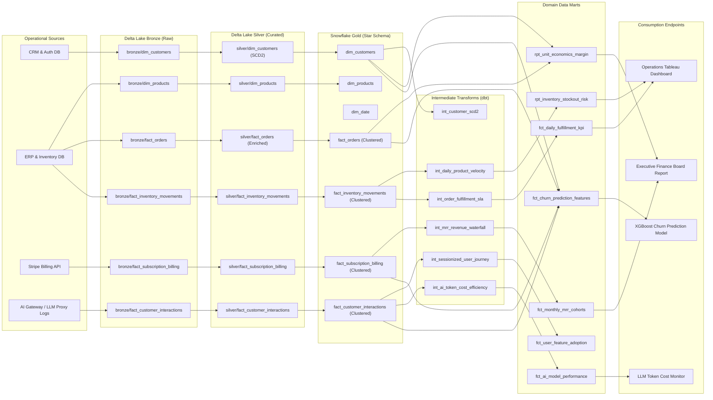

# Enterprise Data Governance & Lineage Specification

## 1. Governance Operating Framework & Ownership Matrix

This document defines the data governance policies, ownership mapping, lifecycle management, and end-to-end data lineage across the 3-Layer Delta Lakehouse and Snowflake Data Warehouse.

### RACI Governance Matrix
| Core Entity | Table | Data Owner | Data Steward | Technical Custodian | Primary Consumer Domains |
| :--- | :--- | :--- | :--- | :--- | :--- |
| **Customer** | `dim_customers` | VP of Product | Head of CRM Analytics | Lead Data Engineer | Finance, Product, AI Feature Store |
| **Product** | `dim_products` | Head of Product | Catalog Ops Specialist | Analytics Engineer | Operations, Finance, Product |
| **Order / Sales** | `fact_orders` | Operations Lead | Order Management Lead | Lead Data Engineer | Operations, Finance |
| **Inventory** | `fact_inventory_movements` | Operations Lead | Logistics & WMS Manager| Data Engineer | Operations, Procurement |
| **Billing & MRR** | `fact_subscription_billing` | Head of Finance | RevOps Analytics Lead | Lead Data Engineer | Executive, Finance, Sales |
| **AI Telemetry** | `fact_customer_interactions`| AI Platform Lead | MLOps Engineer | ML Infrastructure Engineer | Product, AI Ops, ML Modeling |
| **Calendar** | `dim_date` | Governance Council | Analytics Engineering | Analytics Engineer | All Enterprise Domains |

---

## 2. End-to-End Data Lineage

The following lineage graph tracks data transformation from source transactional applications, through Delta Lake Bronze and Silver, into Snowflake Gold Star Schema, and out to domain-specific Data Marts and Machine Learning feature consumers:

---

## 3. Data Classification & Security Standards

| Classification | Definition | Examples | Storage Controls | Access Controls |
| :--- | :--- | :--- | :--- | :--- |
| **Public** | Information approved for unrestricted public release. | Calendar dimensions, public pricing lists, country codes. | Standard AES-256 encryption. | Read access to all authenticated roles. |
| **Internal** | Operational data intended for internal enterprise visibility. | Warehouse inventory balances, supplier lead times, product catalog. | Standard encryption at rest. | Granted to `BI_ANALYST`, `DATA_ENGINEER`, `ANALYTICS_ENGINEER`. |
| **Confidential** | Business data that could cause financial or competitive harm if leaked. | Sales order volumes, individual order items, margins, customer names. | Snowflake encryption + Audit Logging. | Restricted to authorized domain analysts and engineers. |
| **Restricted (PII)** | Personally Identifiable Information or sensitive revenue data. | Customer emails, phone numbers, individual billing invoices, churn risk scores. | Column-level Dynamic Masking (`mask_email`, `mask_phone`). | Restricted to `ACCOUNTADMIN`, `SECURITYADMIN`, and `DATA_ENGINEER`. |

---

## 4. Data Quality Contracts & Testing SLA

Every table ingested and transformed passes automated schema tests before being promoted:
1. **Uniqueness Tests**: Primary keys (`customer_sk`, `product_sk`, `order_sk`, `billing_sk`, `movement_sk`, `interaction_sk`) must have zero duplicate values.
2. **Not-Null Constraints**: Mandatory operational fields (dates, amounts, customer identifiers) must have zero null values.
3. **Referential Integrity Tests**: Foreign keys in Fact tables must cleanly join to primary keys in Dimension tables without orphaned records.
4. **Range / Value Boundaries**:
   - `quantity` $> 0$
   - `net_amount` $\ge 0$
   - `churn_risk_score` between $0.0$ and $1.0$
   - `reliability_score` between $0.0$ and $1.0$
5. **Freshness SLAs**:
   - Fact Tables: Ingested every 60 minutes with max latency of 2 hours.
   - Dimension Tables: Processed daily at 02:00 UTC.
   - Data Marts: Refreshed every morning at 04:00 UTC prior to executive reporting.
